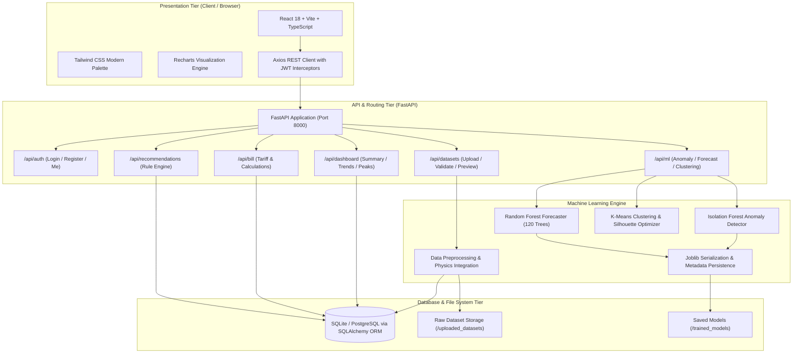
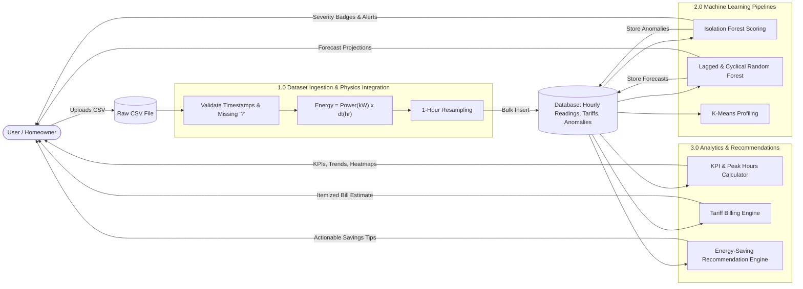
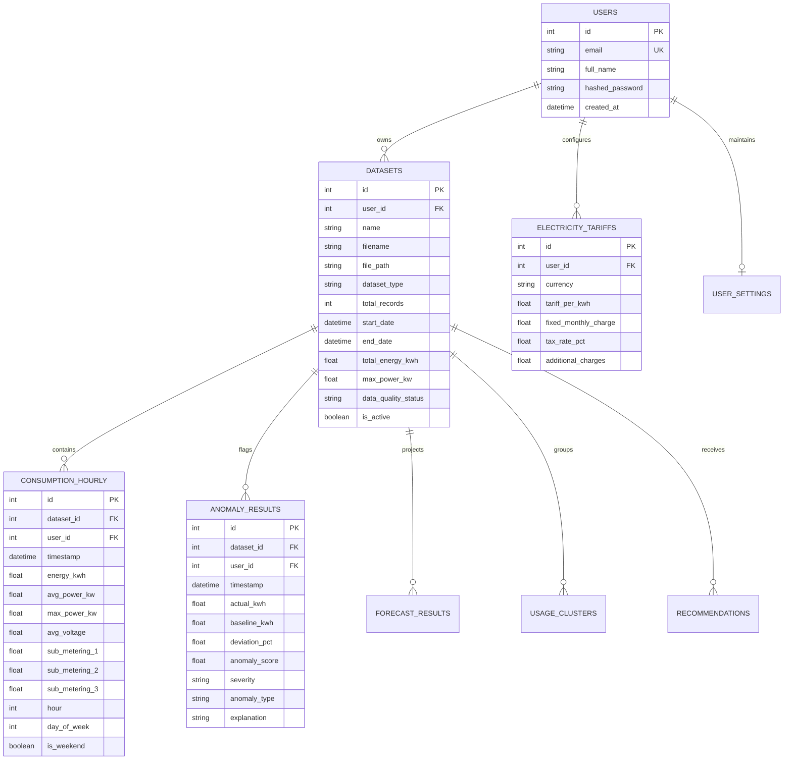

# PowerPulse AI – System Architecture & Technical Diagrams

## 1. System Architecture Diagram

---

## 2. Data Flow Diagram (DFD Level 1)

---

## 3. Use Case Diagram

```mermaid
flowchart TD
    subgraph Actors
        Student["User / Student Examiner"]
    end

    subgraph UseCases["PowerPulse AI Functional Capabilities"]
        UC1(["Register & Authenticate (JWT)"])
        UC2(["Upload & Validate Smart Meter CSV"])
        UC3(["Load 1-Click Benchmark UCI Dataset"])
        UC4(["Explore Real-Time KPI Dashboard"])
        UC5(["Filter by Date: Today, 7D, 30D, All"])
        UC6(["Detect Consumption Anomalies"])
        UC7(["Forecast 24h & 7D Consumption"])
        UC8(["Profile K-Means Diurnal Clusters"])
        UC9(["Calculate Estimated Bill with Custom Tariffs"])
        UC10(["Review Prioritized Saving Recommendations"])
        UC11(["Download Clean CSV Template"])
    end

    Student --> UC1
    Student --> UC2
    Student --> UC3
    Student --> UC4
    Student --> UC5
    Student --> UC6
    Student --> UC7
    Student --> UC8
    Student --> UC9
    Student --> UC10
    Student --> UC11
```

---

## 4. Database Entity-Relationship (ER) Diagram

